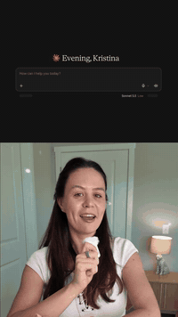
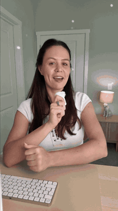

# AI Video Studio by Kristina Bennett

Edit your talking videos with Claude Code, in your own style. Free.

I'm Kristina, and I make videos that explain AI to people without a tech background. This is the setup I use to edit them, packaged so you can use it too.

## Two ways in

### 1. The full studio, from zero

You film. Claude cuts the pauses and mistakes, adds captions and graphics in your style, and renders a finished vertical video for Reels, TikTok or Shorts.

1. Download [VIDEO-STUDIO-SETUP.md](VIDEO-STUDIO-SETUP.md).
2. Put it in a new folder called Video Studio and open that folder in Claude Code.
3. Type `start`.

Step-by-step guide with screenshots: [aiwithkristina.com/guides/video-editing](https://aiwithkristina.com/guides/video-editing/)

### 2. Just the effects

Already editing with Claude Code? Add my 13 effects and 3 caption animations. Open Claude Code in your video folder and type:

> Install Kristina's effects from https://github.com/aiwithkristina/ai-video-studio

Claude follows [effects/INSTALL-EFFECTS.md](effects/INSTALL-EFFECTS.md) and sets everything up in your colors and fonts.

## What's in the effects pack

<table>
<tr><td align="center" width="25%"> <b>01 · Orbit</b> Screenshots circle around you</td><td align="center" width="25%"> <b>02 · Screen wall</b> Screenshots fill the wall behind you</td><td align="center" width="25%"> <b>03 · App world</b> A real app on top, you below</td><td align="center" width="25%"> <b>04 · Frame break</b> You step out of a post frame</td></tr>
<tr><td align="center" width="25%"> <b>05 · Punch-in zoom</b> Hard zoom on a key word</td><td align="center" width="25%"> <b>06 · Phone</b> A 3D phone with a real app</td><td align="center" width="25%"> <b>07 · Checklist</b> A checklist that ticks itself off</td><td align="center" width="25%"> <b>08 · Headline wall</b> Headlines pile up behind you</td></tr>
<tr><td align="center" width="25%"> <b>09 · Zoom-through cut</b> Zoom into one clip, out of the next</td><td align="center" width="25%"> <b>10 · Growth chart</b> A chart draws itself behind you</td><td align="center" width="25%"> <b>11 · Pull-back reveal</b> Your video shrinks into an app</td><td align="center" width="25%"> <b>12 · Green screen</b> Any background, no green screen</td></tr>
<tr><td align="center" width="25%"> <b>13 · Paper cut</b> You as a paper cut-out</td><td align="center" width="25%"> <b>c1 · Word-by-word captions</b> One word at a time</td><td align="center" width="25%"> <b>c2 · Text behind head</b> Huge words behind you</td><td align="center" width="25%"> <b>c3 · Silhouette words</b> Words along your outline</td></tr>
</table>

Click a preview to watch it with sound. All demos are me, edited with this pack.

Every effect runs on your own video, with your words, your colors and your fonts. My footage appears only in these demos.

## What you need

- A Mac with Claude Code (a Claude Pro or Max plan)
- About 5 GB of free space for the effects, more for the full studio
- Your own videos and real screenshots of the apps you talk about

## For developers

The effects run on a small Python engine in [effects/engine](effects/engine/README.md): ffmpeg in and out, a person cutout, word timings and brand settings. Each effect is one short `effect.py`. Run `python effects/run.py list` to see them all.

## License in plain words

Free to use, not to redistribute. The full text is in [LICENSE](LICENSE).

**You can:** edit your own videos and your clients' videos with it, including paid work; change the effects for your own use. The videos you make are yours, no credit needed.

**You can't:** sell this pack or a changed version of it, put it in a paid course, template pack or bundle, or upload copies anywhere else, even for free.

**Want to share it?** Share the link to this page.

## Credits

- Video rendering in the full studio: [HyperFrames](https://github.com/heygen-com/hyperframes)
- Person cutout: [Robust Video Matting](https://github.com/PeterL1n/RobustVideoMatting) (GPL-3.0), downloaded on first use, not included
- Fonts: Google Fonts (SIL Open Font License)

Built by Kristina Bennett · [aiwithkristina.com](https://aiwithkristina.com)
